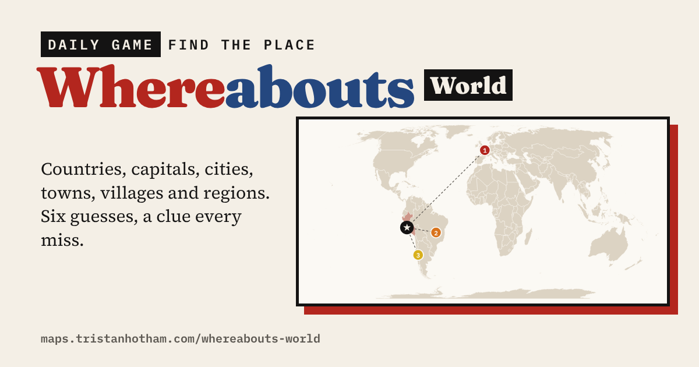

# Whereabouts World

A daily map game: find the mystery country, capital, city, town, village or region anywhere in the world in six goes. **[Play it](https://maps.tristanhotham.com/whereabouts-world/)**

## How it works

- Pick a mode: **Country**, **Capital**, **City**, **Town**, **Village** or **Region**.
- Type a guess and pick it from the list. Each guess shows how far away the answer is, which way to go, and how close you are (0% at 20,000 km). The map zooms in on your guesses, and in Country and Region modes it shades the places you've tried.
- Every wrong guess unlocks a clue: size; climate; money and life expectancy in its country; the oddest thing about its country; where it is; and finally its first letter.
- At the end you see the answer on the map, what its country's name means, a grid to share and your stats.
- **Today's** answer is the same for everyone and is worked out in your browser from the date, so there is a new one every day. Each mode has its own daily list, streak and stats, and the list reshuffles each time it runs out. **Practice** gives you a random answer whenever you like.

| Mode | Daily answers | Practice answers |
| --- | --- | --- |
| Country | 196 sovereign countries | the same |
| Capital | 195 capital cities | the same |
| City | about 560 cities of 1 million+ | about 1,180 cities of 500,000+ |
| Town | about 1,100 towns of 15,000 to 100,000 | about 2,400 |
| Village | about 670 villages of 500 to 5,000 | about 1,700 |
| Region | about 690 states and provinces in 25 countries | about 1,040 in 41 countries |

Towns and villages are the better-known ones in each country (those with names recorded in the most languages), capped per country so the whole world gets a turn. The UK version, with towns, cities, villages and counties, is [Whereabouts](https://github.com/Tristan-Hotham/whereabouts).

## Files

- `index.html`: the game (one page, no build step)
- `w_country.json`, `w_capital.json`, `w_city.json`, `w_town.json`, `w_village.json`, `w_region.json`: answers with clues, and the list of places you can guess, for each mode (region also holds the region outlines)
- `map.json`: simplified country boundaries on an Equal Earth projection
- `code/`: the Python scripts that build the data (`ww_build.py` and `ww_region.py`)

## Sources

- Places, populations and capitals: [GeoNames](https://www.geonames.org/) (CC BY 4.0), via the geonamescache package.
- Regions and borders: [Natural Earth](https://www.naturalearthdata.com/) admin-0 and admin-1 (public domain). Italy, Spain and France use their regions; the UK its four nations.
- Climate: [NASA POWER](https://power.larc.nasa.gov/) long-term average air temperature on a half-degree grid.
- Country facts: the 67 measures in [Higher or Lower: World](https://github.com/Tristan-Hotham/higher-or-lower-world) (CIA World Factbook, Our World in Data, UNESCO, USGS, Wikipedia).
- Name meanings: my [country names](https://maps.tristanhotham.com/country-names/) study, from Wikipedia's list of country-name etymologies (CC BY-SA 4.0).

Distances are as the crow flies between place centres (for countries and regions, a point inside them). Populations are GeoNames figures and can be dated.

## Licence

Code: MIT. Data: CC BY-SA 4.0, keeping the attributions above.

Dr Tristan Hotham, independent researcher · 2026 · [tristanhotham.com](https://tristanhotham.com)

AI use: built with coding and drafting help from Claude (Anthropic). I reviewed and checked the data and text.
